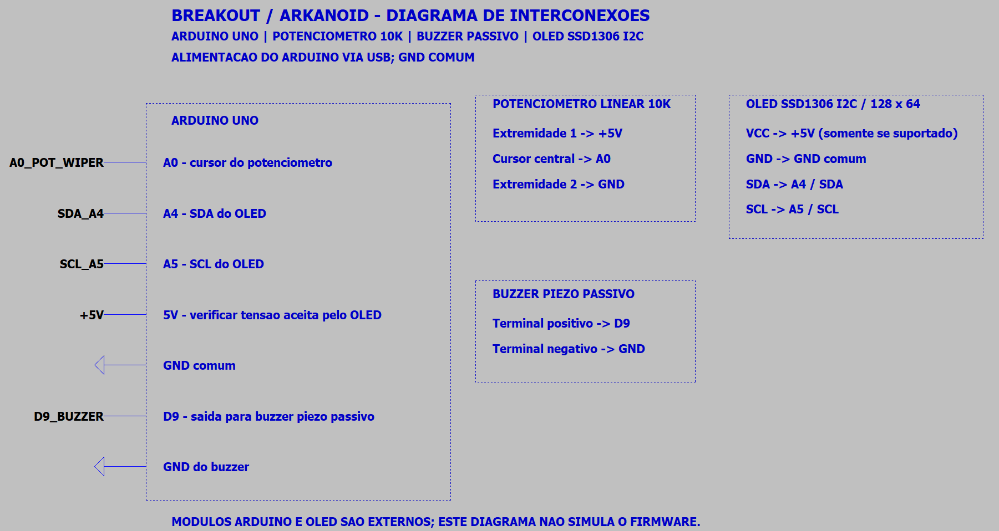
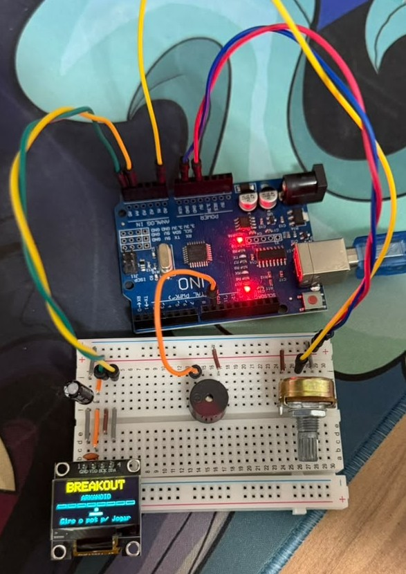
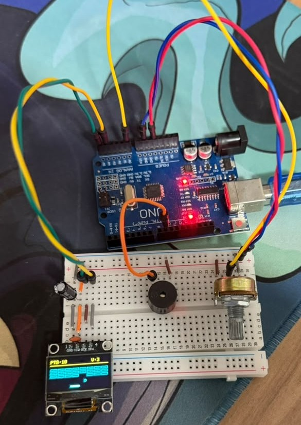
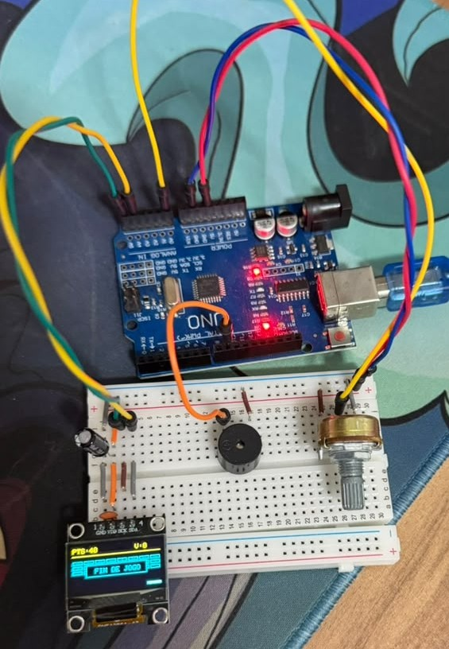

<div align="center">

# 🧱 Breakout / Arkanoid

**Jogo Breakout para Arduino Uno com display OLED, controle por potenciômetro e efeitos sonoros no buzzer**

[](https://www.arduino.cc/)
[](https://isocpp.org/)

</div>

---

## 📋 Descrição

O **Breakout / Arkanoid** adapta o clássico jogo de arcade para um Arduino Uno. O potenciômetro controla a raquete, a bola rebate nas bordas e destrói blocos exibidos em um OLED SSD1306. Os blocos têm diferentes pontos de resistência, e o buzzer passivo sinaliza colisões.

O firmware usa colisão AABB (Axis-Aligned Bounding Box) separada nos eixos X e Y, com estado de jogo mantido em memória estática para caber na SRAM limitada do Uno.

---

## ⚙️ Componentes Utilizados

| Quantidade | Componente | Especificação |
|:---:|---|---|
| 1x | Arduino Uno (ou compatível) | ATmega328P |
| 1x | Display OLED | SSD1306 I2C, 128×64, endereço 0x3C (confirmar no módulo) |
| 1x | Potenciômetro | 10 kΩ linear para mover a raquete |
| 1x | Buzzer piezo passivo | Para efeitos de colisão via `tone()` |
| — | Jumpers e protoboard | — |

> O firmware usa bibliotecas Adafruit GFX e Adafruit SSD1306. Confirme a tensão aceita pelo módulo OLED antes de ligá-lo ao Arduino.

---

## 🔌 Pinagem

```text
Arduino Uno
├── A0  → Terminal central do potenciômetro
├── 5V  → Extremidade do potenciômetro e VCC do OLED (se suportado)
├── GND → Outra extremidade do potenciômetro, GND do OLED e buzzer
├── A4  → SDA do OLED
├── A5  → SCL do OLED
└── D9  → Buzzer piezo passivo
```

O potenciômetro deve ser ligado como divisor de tensão entre 5V e GND, com o cursor em A0. Arduino Uno e OLED usam I2C em A4/SDA e A5/SCL. Use buzzer passivo para permitir diferentes frequências.

---

## 🖼️ Esquemático e montagem

### Esquemático elétrico



O arquivo [breakout-arkanoid.asc](Esquemático/breakout-arkanoid.asc) registra as interconexões e os pinos usados pelo firmware. Arduino e OLED são módulos externos, não modelos SPICE simulados.

### Montagem real

Montagem em protoboard com Arduino Uno, OLED SSD1306, potenciômetro e buzzer passivo. Tela de boas-vindas:



Jogo em andamento (placar na faixa amarela, blocos e raquete na azul) e tela de fim de jogo:





---

## 💻 Como Funciona

### Controle e renderização

O valor analógico de A0 posiciona a raquete na parte inferior do OLED. O firmware desenha a bola, a raquete, os blocos, a pontuação e as vidas no framebuffer do SSD1306.

### Física e colisões

A posição da bola é atualizada separadamente em X e Y. Cada deslocamento verifica interseção AABB com as paredes, a raquete e os blocos; separar os eixos permite inverter apenas o componente de velocidade correspondente ao contato. Em colisão com um bloco, a posição anterior da bola é restaurada para que ela não fique dentro do bloco e não cause acertos duplicados. Após cada vida perdida há uma pausa de 800 ms antes do lançamento, e a raquete sempre devolve a bola com uma componente horizontal mínima.

### Blocos e áudio

Os blocos têm níveis de HP diferentes (1 a 3, indicados por 0, 1 ou 3 pontos no centro do bloco). Cada contato reduz o HP; ao destruir um bloco, a pontuação aumenta. O buzzer toca efeitos curtos sem interromper o ciclo principal do jogo.

---

## 🗂️ Estrutura dos Arquivos

```text
breakout-arkanoid/
├── README.md
├── circuit_images/                  # Esquemático exportado e fotos da montagem
├── Esquemático/
│   └── breakout-arkanoid.asc        # Diagrama de interconexões LTspice
└── sketch_breakout-arkanoid/
    └── sketch_breakout-arkanoid.ino # Firmware principal
```

---

## 🚀 Como Usar

1. Instale a Arduino IDE e as bibliotecas Adafruit GFX Library e Adafruit SSD1306.
2. Monte o circuito conforme a pinagem e confira a tensão do OLED.
3. Abra `sketch_breakout-arkanoid/sketch_breakout-arkanoid.ino`.
4. Selecione Arduino Uno e a porta serial correta.
5. Faça upload. Ao ligar aparece a tela de boas-vindas com uma melodia curta; gire o potenciômetro para começar (ou aguarde 8 s) e use-o para controlar a raquete.

---

## 🔧 Personalização

Os parâmetros de velocidade, dimensões da raquete e configuração da grade de blocos ficam no início do sketch. Ajuste-os conforme a resposta do controle e a taxa de atualização observadas no hardware.

O módulo OLED bicolor (amarelo/azul) tem as 16 primeiras linhas amarelas: por isso o placar fica nessa faixa (`HUD_HEIGHT`) e o campo de jogo na faixa azul. Se girar o potenciômetro mover a raquete no sentido contrário ao esperado, inverta os dois valores finais do `map()` em `updatePaddle()` ou troque os terminais externos do potenciômetro. Em um OLED de uma cor só, `HUD_HEIGHT` pode ser reduzido.

---

## ✅ Estado e Próximos Passos

- [x] Criar estrutura inicial do projeto e firmware base.
- [x] Registrar pinagem e diagrama de interconexões LTspice.
- [x] Compilar e validar o firmware no Arduino Uno com o OLED real.
- [ ] Calibrar movimento, dificuldade e efeitos sonoros no circuito montado.
- [x] Adicionar imagens do esquemático e da montagem em `circuit_images/`.

*Desenvolvido por Felipe Grolla*
